# Fitnessstudio-Plattform – ein Ideenprojekt mit Vibe-Coding

> [!IMPORTANT]
> **Dies ist ein Demo- und Lernprojekt.** Die Marke „Ahankooh“ ist frei erfunden; alle Mitglieder, Umsätze und Bestellungen sind fiktive Beispieldaten, Zahlungen laufen über ein Test-Gateway und es werden keine echten SMS verschickt.
>
> **▶ Live-Demo ansehen: [gymapp-vqzk.onrender.com](https://gymapp-vqzk.onrender.com/?brand=demo)** · Ins Panel per Ein-Klick-Login auf der Login-Seite

Eine Web-Plattform für eine (fiktive) Fitnessstudio-Kette mit 12 Standorten: öffentliche Website, Online-Mitgliedschaft mit Bezahlung, Shop, Kantine mit QR-Bestellung und ein Mitarbeiter-Panel für Empfang, Trainer und Leitung. Die Oberfläche ist auf Persisch (Rechts-nach-links) – ein bewusst gewählter Härtetest für Layout und Typografie.

## Live-Demo

**👉 [gymapp-vqzk.onrender.com](https://gymapp-vqzk.onrender.com/?brand=demo)**

- **Ein-Klick-Login:** Auf der Login-Seite gibt es die Schaltflächen „Gesamtleitung“, „Standortleitung“ und „Mitglied“ – ohne Nummer und Code direkt ins Panel bzw. ins Mitgliedskonto.
- Alternativ mit **09100000000** (alle Rollen) oder **09100000001** (Standortleitung) anmelden – der SMS-Code wird im Demo-Modus direkt auf der Seite angezeigt.
- Ein oranger Hinweisbalken oben auf jeder Seite kennzeichnet die Demo.
- Zahlungen laufen über ein Test-Gateway, es wird kein echtes Geld bewegt.
- Die Demo läuft im kostenlosen Render-Tarif: Nach 15 Minuten ohne Zugriff schläft sie ein, der erste Aufruf dauert dann etwa eine Minute. Demo-Daten werden bei jedem Neustart neu erzeugt.

### Screenshots

| Startseite | Standorte mit Karte |
|---|---|
| 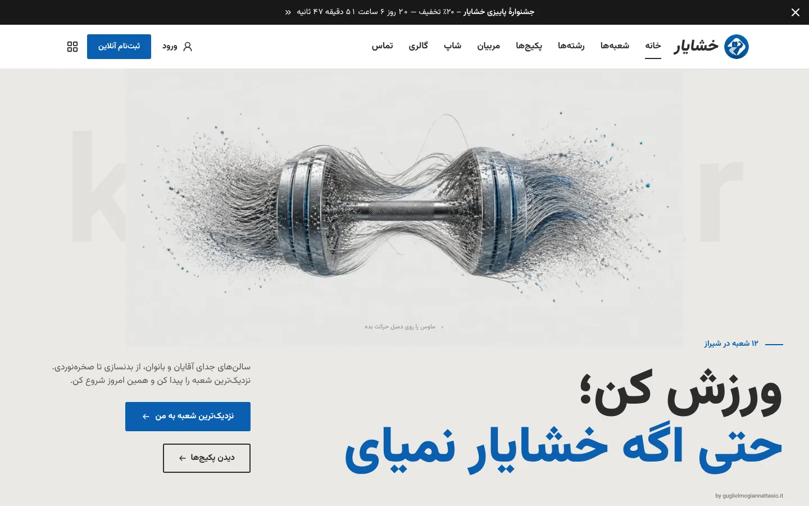 | 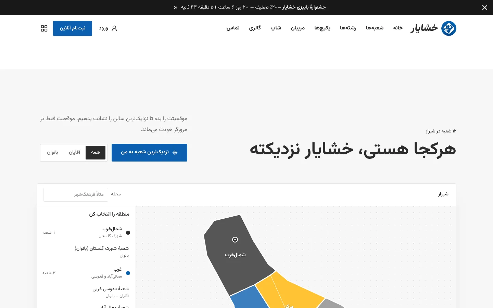 |
| **Pakete** | **Online-Anmeldung** |
| 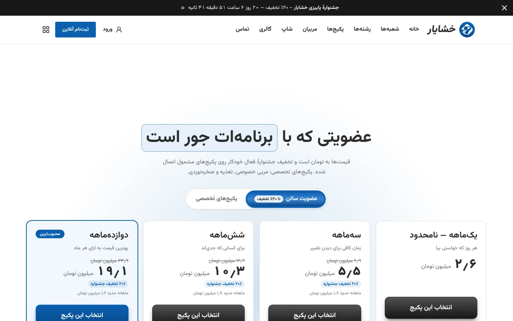 | 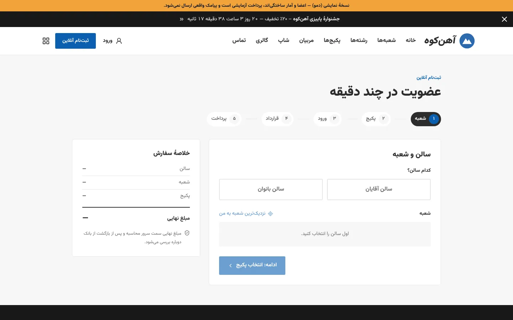 |
| **Shop** | **Dashboard der Leitung** |
| 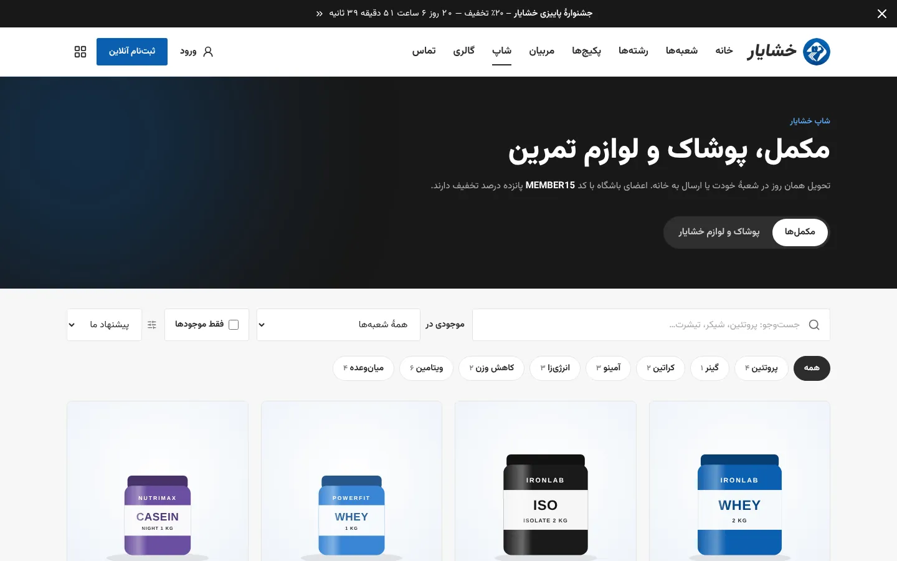 | 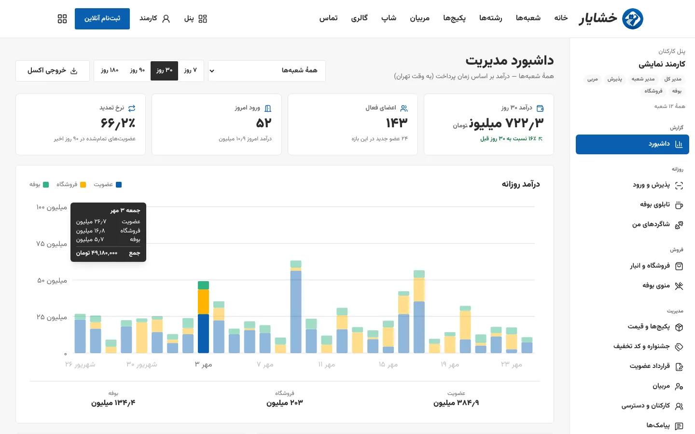 |
| **Empfang und Check-in** | **Trainer-Panel** |
| 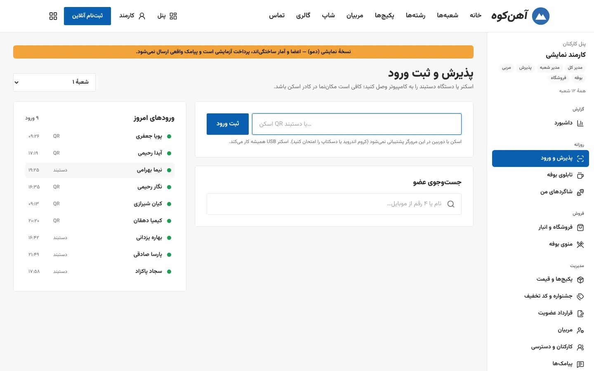 | 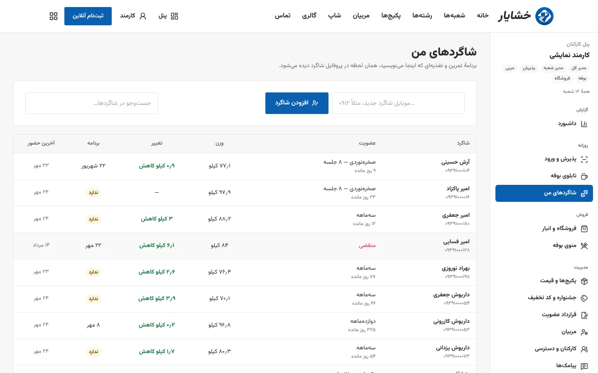 |
| **Kantinen-Menü verwalten** | **Trainer verwalten** |
| 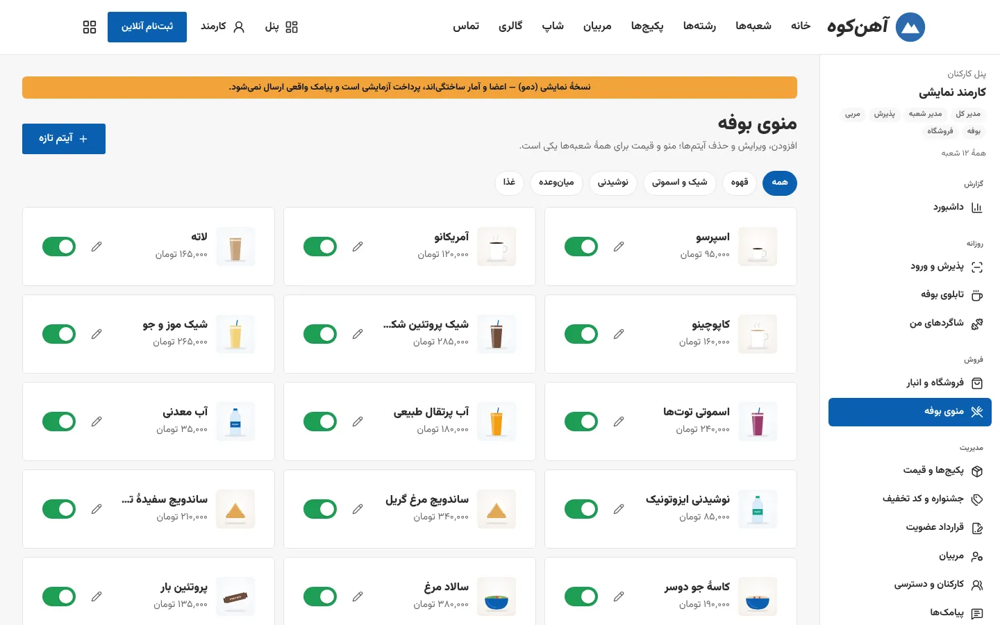 | 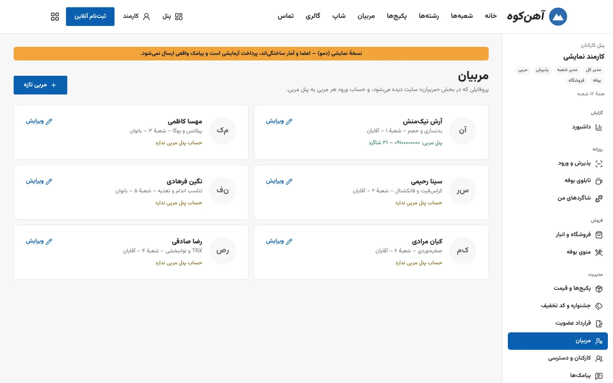 |
| **Login mit Ein-Klick-Demo-Zugang** | |
| 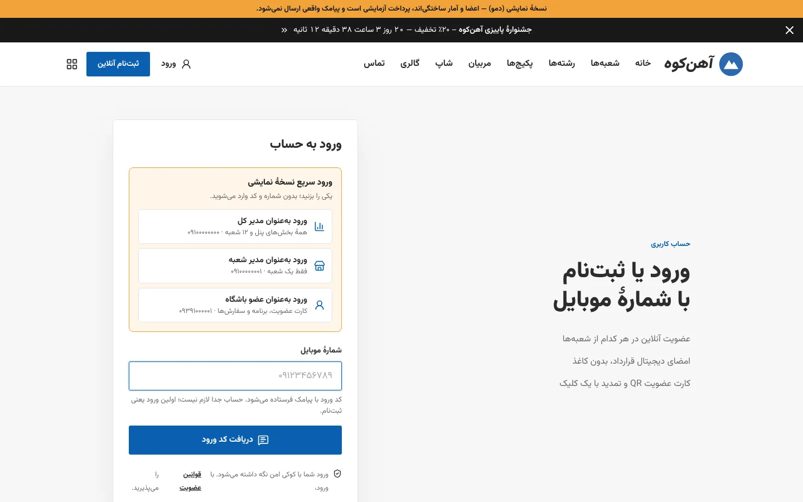 | |

| Mitgliedskarte (mobil) | Kantine per QR (mobil) |
|---|---|
| 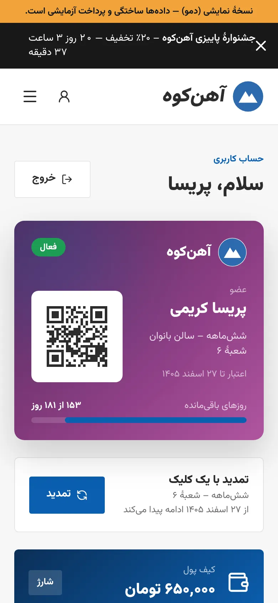 | 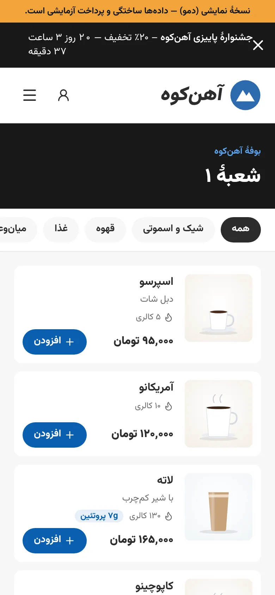 |

## Die Idee: aus Neugier gebaut, komplett mit Vibe-Coding

Dieses Projekt ist kein Auftrag und kein Produkt, sondern eine Sammlung von Ideen, die ich aus Neugier ausprobieren wollte: Wie weit kommt man mit **komplettem Vibe-Coding**, wenn man eine realistische, große Anwendung baut – mit Drei-Schichten-Architektur, Zahlungen, Rollen, Echtzeit-Funktionen, Sicherheits-Audit und Tests?

Ich habe die Ideen, die Anforderungen und jede Phase in natürlicher Sprache beschrieben, die Ergebnisse geprüft, getestet und Schritt für Schritt nachgesteuert – den Code selbst hat eine KI geschrieben. Es war meine erste Erfahrung dieser Art und für mich **sehr spannend und eine richtig gute Erfahrung**: In kurzer Zeit ist etwas entstanden, das ich allein so nicht hätte bauen können. Gleichzeitig habe ich gelernt, wie wichtig klare Anforderungen, Planung vor jeder Phase und konsequentes Testen sind, damit am Ende etwas Belastbares herauskommt.

## Funktionen

- **Phase 1 – Öffentliche Website:** Scroll-Hero, Standortkarte mit „nächster Standort“, Pakete mit Aktionsrabatt, Trainer, Galerie, Beratungsformular.
- **Phase 2 – Mitgliedschaft:** Login per Handynummer und SMS-Code, mehrstufige Online-Anmeldung (Standort → Paket → Login → Vertrag → Zahlung), digitaler Vertrag und Gesundheitsfragebogen mit SMS-Signatur, Zahlung (Test-Gateway / ZarinPal), PDF-Rechnung, QR-Mitgliedskarte und Profil.
- **Phase 3 – Shop & Kantine:** Shop (Supplements, Kleidung, Zubehör, Bestand pro Standort), Kantinen-Menü per QR-Code am Tisch mit Live-Bestelltafel (SignalR), Wallet, Aktionsseite, Anbindung an Drehkreuz/Armband.
- **Phase 4 – Mitarbeiter-Panel:** Dashboard für die Leitung (Umsatz der 12 Standorte nach Quelle, Verlängerungsrate, Stoßzeiten, auslaufende Mitgliedschaften, Aktionswirkung, Excel-Export), Empfang mit Scanner/Kamera/Armband, Trainer-Panel (Trainings- und Ernährungsplan, Gewichtsverlauf), Verwaltung von Preisen, Aktionen, Rabattcodes, Vertrag, Lager, Kantinen-Menü, Trainern und Mitarbeitern, automatische SMS, Präsentationsmodus.
- **Phase 5 – Qualität:** unabhängiges Sicherheits-Audit mit behobenen Befunden, Performance-Optimierung, Barrierefreiheit, Health-Checks, CI.

## Technologien


| Bereich | Technologie | Wofür |
|---|---|---|
| Backend | ASP.NET Core 10 Web API, C# | REST-API `/api/v1`, Sicherheit, Output-Caching, Rate-Limiting, Health-Checks |
| Daten | EF Core 10, SQL Server (Production), SQLite (Demo) | Drei-Schichten-Zugriff, Migrationen, atomare bedingte Updates |
| Login | ASP.NET Identity, JWT, rotierende Refresh-Tokens (HttpOnly-Cookie) | Login per Handynummer + SMS-Code, Rollen und Standort-Rechte |
| Validierung | FluentValidation | alle Eingaben in der Business-Schicht |
| Zahlung | Parbad (ZarinPal + Test-Gateway) | Mitgliedschaft, Shop, Kantine, Wallet |
| Echtzeit | SignalR | Live-Bestelltafel der Kantine |
| Dokumente | QuestPDF, ClosedXML, QRCoder | PDF-Rechnung und -Vertrag, Excel-Export, QR-Mitgliedskarte |
| Logging | Serilog | strukturierte Logs, Audit-Log in der Datenbank |
| Frontend | React 19, TypeScript, Vite 8, React Router 7 | Single-Page-App, vollständig RTL/Persisch |
| Design | Tailwind CSS 4, Motion, Lucide, Komponenten von 21st.dev | Hero mit Partikel-Hantel, Scroll-Animationen, Panels |
| Tests | xUnit + WebApplicationFactory, Playwright | 77 Server- und 33 Browser-Tests (Desktop und Mobil) |
| Betrieb | Docker (mehrstufig), docker-compose, Render, GitHub Actions | Image ohne Root, Demo-Hosting, CI mit Sicherheitsprüfung |

## Architektur (drei Schichten, .NET 10)

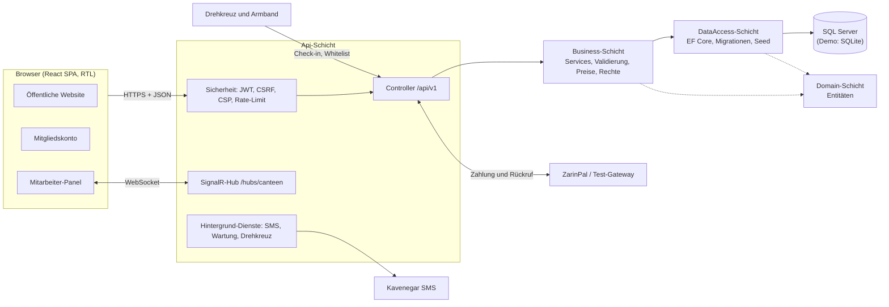

### Ablauf der Online-Mitgliedschaft

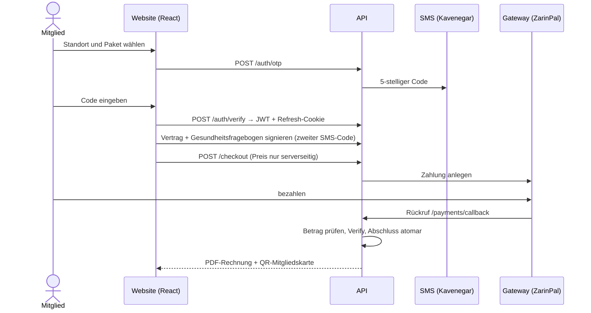

### Rollen und Zugriff

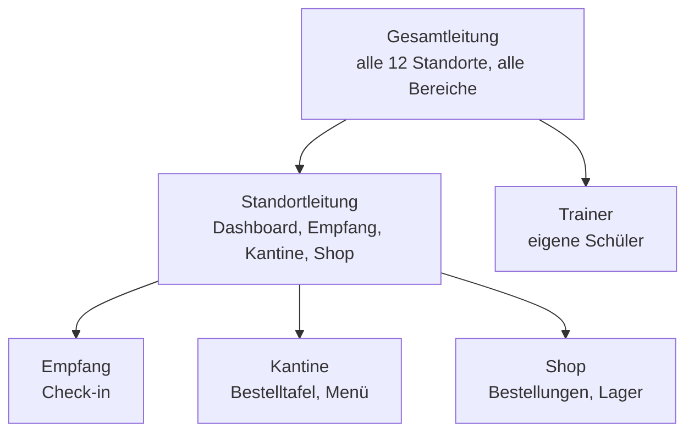

Rolle und Standort werden bei jeder Anfrage aus der Datenbank gelesen; jede Rolle sieht nur die Daten ihrer eigenen Standorte.

### Projektstruktur

```
GymPlatform.slnx
src/
  GymPlatform.Domain       Entitäten und Enums
  GymPlatform.DataAccess   EF Core, DbContext, Repositories, Migrationen, Beispieldaten (Seed/*.json)
  GymPlatform.Business     Services, DTOs, Validierung (FluentValidation), Preisberechnung
  GymPlatform.Api          Web-API, Sicherheit, Caching, liefert das Frontend aus wwwroot aus
  GymPlatform.Web          React + Vite + TypeScript + Tailwind v4 (Build → Api/wwwroot)
tests/GymPlatform.Tests    xUnit-Tests (Business) und Integrationstests (WebApplicationFactory)
src/GymPlatform.Web/e2e    Playwright-Tests (Desktop und Mobil)
scripts/                    Hilfsskripte (Hero-Video, Bilder, Komprimierung)
render.yaml                 Render-Blueprint für die Live-Demo
```

## Voraussetzungen

- .NET SDK 10
- Node.js 22 oder neuer
- SQL Server LocalDB (kommt mit Visual Studio) – oder ohne Datenbankserver mit SQLite (siehe unten)
- ffmpeg (nur zum Erzeugen der Hero-Video-Frames)

## Start in Visual Studio (ein Klick)

1. `GymPlatform.slnx` in Visual Studio öffnen.
2. `GymPlatform.Api` als Startprojekt festlegen.
3. Oben das Profil **Demo (SQLite)** wählen und ▶ drücken.

Der Browser öffnet http://localhost:5180. Die Demo-Datenbank (`gym-demo.db`) wird automatisch angelegt, ein SQL Server ist nicht nötig.

## Start über die Kommandozeile (SQLite-Demo)

```powershell
cd src\GymPlatform.Web
npm install
npm run build            # Ausgabe nach src\GymPlatform.Api\wwwroot

cd ..\GymPlatform.Api
$env:Database__Provider = "Sqlite"
$env:ConnectionStrings__Default = "Data Source=gym-demo.db"
dotnet dev-certs https --trust     # nur beim ersten Mal
dotnet run --launch-profile https
```

Danach https://localhost:7180 öffnen. Datenbank und Beispieldaten werden automatisch erstellt.

## Start mit SQL Server (LocalDB)

```powershell
cd src\GymPlatform.Api
dotnet run --launch-profile https   # Migrationen werden automatisch angewendet
```

Eine andere Verbindungszeichenfolge gehört in die User Secrets, nicht in `appsettings.json`:

```powershell
dotnet user-secrets init
dotnet user-secrets set "ConnectionStrings:Default" "Server=...;Database=GymPlatform;..."
```

## Frontend-Entwicklung mit Hot Reload

```powershell
# Terminal 1
cd src\GymPlatform.Api; dotnet run --launch-profile https
# Terminal 2
cd src\GymPlatform.Web; npm run dev     # http://localhost:5173, /api wird an https://localhost:7180 weitergeleitet
```

## Demo-Zugänge

| Zugang | Telefonnummer | Rechte |
|---|---|---|
| Demo-Mitarbeiter | 09100000000 | alle Rollen inkl. Gesamtleitung |
| Demo-Standortleitung | 09100000001 | nur ein Standort |
| Demo-Mitglieder | 09391000001 und folgende | Mitgliedskonto mit Karte, Bestellungen, Plan |

- Im Demo-Modus wird keine echte SMS verschickt – der **Code erscheint direkt auf der Seite**.
- Rabattcodes (nur Demo): `WELCOME5` und `MEMBER15` (nur für aktive Mitglieder).
- Das Test-Gateway (Parbad Virtual) bewegt kein echtes Geld: **Pay** = erfolgreich, **Cancel** = abgebrochen.
- In der Entwicklungsumgebung werden 200 fiktive Mitglieder mit 6 Monaten Historie erzeugt; in Production niemals.
- **Präsentationsmodus:** im Panel unten in der Seitenleiste „Präsentationsmodus“ anklicken oder `?present=1` an die Adresse hängen – eine schwebende Leiste wechselt zwischen Kunden-, Empfangs-, Kantinen-, Trainer- und Leitungsansicht.

### Demo-Abläufe

- **Anmeldung:** „Online-Anmeldung“ im Header → Standort (Button „nächster Standort“) → Paket und Rabattcode → Login → Vertrag und Gesundheitsfragebogen signieren → Zahlung → PDF-Rechnung und QR-Karte. Unter `/profile`: Resttage, Verlängerung mit einem Klick, Rechnungen, Vertrags-PDF, Trainingsplan und Gewichtsdiagramm.
- **Shop:** `/shop` – Kategorien, Standort für den Bestand wählen, Farbe und Größe, Warenkorb, Abholung oder Versand.
- **Wallet:** `/wallet` – Aufladen über das Gateway, Bezahlen in Shop und Kantine.
- **Kantine (Gast):** `/canteen/<standort>?table=Tisch 4` – dieselbe Adresse, die der QR-Code am Tisch öffnet.
- **Kantine (Personal):** als 09100000000 anmelden und `/panel/canteen` öffnen und einen Standort wählen; Bestellungen erscheinen live, bei „fertig“ piept das Handy des Gastes. Druckvorlage der Tisch-QR-Codes: `/panel/canteen/qr`.

## Rollen und Rechte im Panel

| Rolle | Bereiche | Umfang |
|---|---|---|
| Gesamtleitung (SuperAdmin) | alle Bereiche, inkl. Pakete, Aktionen, Vertrag, Trainer, Mitarbeiter, SMS | alle 12 Standorte |
| Standortleitung | Dashboard, Empfang, Kantinentafel, Shop & Lager, Kantinen-Menü (nur verfügbar/nicht verfügbar) | eigene Standorte |
| Empfang | Empfang und Check-in | eigene Standorte |
| Trainer | „Meine Schüler“ | eigene Schüler |
| Kantine | Kantinentafel, Kantinen-Menü | eigene Standorte |
| Shop | Shop und Lager | eigene Standorte |

- Rolle und Standort werden bei jeder Anfrage aus der Datenbank gelesen; Änderungen unter „Mitarbeiter und Rechte“ gelten sofort.
- **Trainer:** unter „Trainer“ wird ein Trainerprofil angelegt (Name, Fachgebiet, Standort, Bereich Herren/Damen, Erfahrung, Erfolge, Foto, Sichtbarkeit auf der Website). Das Feld „Handynummer des Trainers“ legt das Login-Konto an und vergibt automatisch die Trainer-Rolle. Trainer mit Schülern oder Plänen können nicht gelöscht, nur ausgeblendet werden.
- **Inhalte mit Bildern:** Kantinen-Menü, Produkte (mit Größen/Farben und eigenem Preis) und Pakete werden von der Gesamtleitung angelegt, bearbeitet und gelöscht. Bilder können hochgeladen (jpg/png/webp, max. 2 MB, Prüfung der Dateisignatur, kein SVG, Speicherung außerhalb von wwwroot) oder aus den vorhandenen Website-Bildern gewählt werden.

## Automatische SMS

Willkommen/Verlängerungsbestätigung (sofort), Erinnerung 7 und 1 Tag vor Ablauf, Geburtstag (persischer Kalender, mit Einmal-Rabattcode für den Shop) und Aktionen (nur abgelaufene Mitglieder mit Werbe-Einwilligung). Erinnerungen und Werbung nur zwischen 9 und 21 Uhr; jede SMS per eindeutigem Schlüssel nur einmal. Vier Kavenegar-Vorlagen (Willkommen, Verlängerung, Geburtstag, Aktion; je 3 Tokens). Website-Adresse im SMS-Text: `Sms:SiteUrl`.

## Drehkreuz- und Armband-Anbindung

Technische Schnittstellen-Doku: [`docs/access-control-api.md`](docs/access-control-api.md). In der Entwicklungsumgebung wird ein Demo-Gerät angelegt (Schlüssel in `appsettings.Development.json`).

## Vom Demo- zum Echtbetrieb

Für einen echten Betrieb müssten nur Einstellungen geändert werden: `Otp:ExposeCodeInResponse=false`, `Sms:Provider=Kavenegar` mit Schlüssel in den User Secrets und `Payment:UseVirtualGateway=false` mit einem echten Gateway (Parbad unterstützt ZarinPal, IDPay, Saman, Mellat u. a.). Der ProductionGuard verhindert den Start, solange Demo-Einstellungen aktiv sind.

## Docker

```bash
cp .env.example .env      # DB_PASSWORD, JWT_SIGNING_KEY und OTP_PEPPER mit Zufallswerten füllen
docker compose up --build # http://localhost:8080
```

Mehrstufiges Image (Node → .NET SDK → aspnet), läuft als Nicht-Root-Benutzer mit schreibgeschütztem Dateisystem. Vertrags-PDFs und Data-Protection-Schlüssel liegen im Volume `private`, hochgeladene Bilder im Volume `uploads`. Davor gehört ein Reverse-Proxy mit TLS (Cookies sind `Secure`).

## Demo-Deployment auf Render

Das Repository enthält eine fertige **Render-Blueprint-Datei** (`render.yaml`). Damit wird die öffentliche Demo mit wenigen Klicks erstellt:

1. In Render **New → Blueprint** wählen.
2. GitHub verbinden und **nur dieses Repository** freigeben (es ist privat – „Public Git Repository“ findet es nicht).
3. Repository auswählen, Name bestätigen und **Apply** klicken. Render baut das Docker-Image (Frontend + Backend) und startet den Dienst; der erste Build dauert etwa 10 Minuten.
4. Die Adresse `https://<name>.onrender.com` öffnen und mit `09100000000` anmelden – der Code erscheint auf der Seite.

Was die Blueprint einstellt: Docker, Free-Tarif, Region Frankfurt, Health-Check `/health/ready`, automatisches Deployment bei jedem Push auf `master` und diese Umgebungsvariablen:

| Name | Wert |
|---|---|
| `ASPNETCORE_ENVIRONMENT` | `Staging` |
| `PORT` | `8080` |
| `VITE_BRAND` | `demo` (fiktive Marke „Ahankooh“ im Build) |
| `Database__Provider` / `ConnectionStrings__Default` | `Sqlite` / `Data Source=/data/private/kg.db` |
| `Jwt__SigningKey`, `Otp__Pepper` | von Render zufällig erzeugt |
| `Otp__ExposeCodeInResponse` | `true` (Code auf der Seite) |
| `Payment__UseVirtualGateway` | `true` (Test-Gateway) |
| `Demo__StaffPhone` / `Demo__SeedMembers` | `09100000000` / `true` |
| `ReverseProxy__Enabled` | `true` (HTTPS hinter dem Render-Proxy) |
| `DOTNET_gcServer` | `0` (weniger Arbeitsspeicher) |

Die Zahlungs-Rücksprungadresse wird automatisch aus der aufgerufenen Adresse gebildet. `Staging` statt `Production`, weil die Demo bewusst unsichere Einstellungen nutzt – der ProductionGuard würde den Start in Production verhindern.

**Grenzen des Free-Tarifs:** Der Dienst schläft nach 15 Minuten ohne Zugriff ein (der erste Aufruf danach dauert etwa eine Minute), und ohne persistente Festplatte werden die Daten bei jedem Neustart zurückgesetzt und die Demo-Daten neu erzeugt. Für einen echten Betrieb ist SQL Server vorgesehen.

## Tests

```powershell
dotnet test                                   # xUnit + API-Integrationstests (Login, Token-Rotation, Zahlung, Idempotenz)
cd src\GymPlatform.Web
npx playwright install chromium               # einmalig
$env:BASE_URL = "http://localhost:5180"; npx playwright test   # inkl. kompletter Anmeldung mit Zahlung
```

Für komplette Playwright-Läufe das Rate-Limit in der Entwicklung anheben (alle Anfragen kommen von derselben IP):

```powershell
$env:RateLimiting__PermitMultiplier = "20"   # nur Development/Testing; in Production ignoriert
```

Aktuell 110 automatisierte Tests: 77 Server-Tests und 33 Browser-Tests (Desktop und Mobil).

## Daten bearbeiten

- **Standorte:** `src/GymPlatform.DataAccess/Seed/branches.json` – Einträge mit `addressConfirmed: false` haben ungefähre Koordinaten.
- Pakete, Trainer und FAQ: weitere Dateien im selben Ordner (oder später direkt im Panel).
- Seed-Daten werden nur in eine leere Datenbank geschrieben; nach Änderungen die Demo-Datenbank (`gym-demo.db`) löschen bzw. die LocalDB-Datenbank droppen.
- **Marke:** Name, Logo, Slogan und Kontaktdaten stehen in `src/GymPlatform.Web/src/lib/brand.ts`.
- **Farben:** nur im `@theme`-Block von `src/GymPlatform.Web/src/index.css`.

## Frontend

Layout und Stil orientieren sich an einer Referenzseite (Vorlage „GYM Store – Sports Complex“); Code, Texte und Bilder dieser Vorlage wurden nicht kopiert, alles ist neu mit React/Tailwind gebaut. Tokens und Regeln: `design-system/khashayar-gym/MASTER.md`.

| Bereich | Datei | Quelle |
|---|---|---|
| Weißer Sticky-Header + Seitenpanel | `site/SiteHeader.tsx` | Layout der Referenzseite |
| Hero: Partikel-Hantel, die auf die Maus reagiert | `site/SiteHero.tsx` | Liquid Sculpture Hero (21st.dev, guglielmogiannattasio); Hantelbild mit Canva AI erstellt |
| Was wir machen (4 Bildkarten) | `site/SiteWhatWeDo.tsx` | Bilder aus Beispielvideos |
| Warum wir + Zahlen | `site/SiteWhy.tsx` | Count Up (21st.dev) |
| Scroll-Video | `site/SiteVideo.tsx` | Sunset Skyline Hero (21st.dev) – Video: `public/media/video/gym.mp4` |
| Angebot (Icon-Karussell) | `site/SiteOffer.tsx` | Layout der Referenzseite |
| Standorte und Karte | `site/SiteBranches.tsx`, `components/ui/city-branch-picker.tsx` | Struktur von Nepal Address Picker (21st.dev) in Theme-Farben; schematische Stadtkarte |
| Pakete | `site/SitePricing.tsx` | Pricing Section (21st.dev, animierter Umschalter) |
| Aktion (zwei Parallax-Bilder) | `site/SiteEvents.tsx` | Layout der Referenzseite |
| Trainer | `site/SiteCoaches.tsx` | Container Scroll Animation (21st.dev) |
| FAQ | `site/SiteFaq.tsx` | FAQ Accordion (21st.dev) |
| Beratungsformular | `site/SiteContact.tsx` | eigenes Design im Stil der Seite |
| Aktionsleiste | `site/SiteBanner.tsx` | Promo Banner (21st.dev) |
| Galerie | `site/SiteGallery.tsx` | Shared Element Gallery (21st.dev) |
| Dunkler Footer + Newsletter | `site/SiteFooter.tsx` | Layout der Referenzseite |

Änderungen an den Originalkomponenten: feste englische Texte wurden zu persischen Props, dazu RTL-Anpassungen (kein letter-spacing bei Persisch, Pfeilrichtungen). Jede Datei beschreibt oben ihre Änderungen. Die Lizenz dieser Komponenten ist auf 21st.dev „unknown“ – vor kommerzieller Übergabe prüfen. Originaldemos im Entwicklungsmodus: `npm run dev`, dann `http://localhost:5173/lab`.

### Scroll-Video austauschen

Neues Rohvideo als `gym-source.mp4` in `src/GymPlatform.Web/public/media/video/` legen und ausführen:

```powershell
.\scripts\make-scrub-video.ps1
cd src\GymPlatform.Web; npm run build
```

Das Skript macht jeden Frame zum Keyframe, damit Vor- und Zurückspulen beim Scrollen flüssig ist.

### Fiktive Demo-Marke

Mit `?brand=demo` in der Adresse (oder `VITE_BRAND=demo` beim Build) erscheint die erfundene Marke „Ahankooh“: Name, Logo, Slogan, Kontaktdaten sowie Standort- und Ortsnamen werden durch neutrale Beispielwerte ersetzt.

## Sicherheit

**Grundlagen**
- Header: CSP, HSTS (außer Development), X-Content-Type-Options, X-Frame-Options, Referrer-Policy, Permissions-Policy.
- Rate-Limiting pro IP: Formulare 5/min, OTP 5/min, Login 15/min, Zahlung 10/min, global 300.
- CSRF-Schutz per Cookie + Header `X-XSRF-TOKEN` für Gast-Anfragen.
- Validierung aller Eingaben in der Business-Schicht, Normalisierung persischer Ziffern und Handynummern.
- EF Core parametrisiert, kein Roh-SQL; Begrenzung der Request-Größe.
- Der Standort des Nutzers wird nur im Browser verwendet und nicht an den Server gesendet.

**Login, Zahlung, Verträge**
- 5-stelliger SMS-Code, gespeichert nur als HMAC-SHA256 mit Pepper; 2 Minuten gültig, 5 Versuche, 60 Sekunden Abstand, max. 5 Codes pro Stunde und Nummer.
- Kurzlebiges JWT nur im Arbeitsspeicher des Browsers; rotierendes Refresh-Token im Cookie `HttpOnly; Secure; SameSite=Strict`. Nur der Hash liegt in der Datenbank; Wiederverwendung eines alten Tokens beendet alle Sitzungen.
- Beträge werden nur serverseitig berechnet; nach der Rückkehr von der Bank: Abruf, Betragsabgleich, Verify und idempotenter Abschluss in einer Transaktion.
- Signierte Verträge mit SHA-256-Hash des Inhalts, IP, Browser und Zeitstempel; PDFs außerhalb von wwwroot.
- Geheimnisse (JWT-Schlüssel, Pepper, SMS-Schlüssel) nur in User Secrets / Umgebungsvariablen; fehlen sie außerhalb von Development, startet der Server nicht.
- Fehler als ProblemDetails mit `traceId`, ohne interne Details; Audit-Log für Kontoerstellung, Signatur und Zahlung.

**Unabhängiges Audit (Phase 5)**
- **ProductionGuard:** In Production startet der Server nicht, wenn noch Test-Gateway, sichtbarer Login-Code, SMS-Provider „Log“, SQLite, `AllowedHosts=*`, Demo-Geräteschlüssel oder Demo-Einstellungen aktiv sind.
- **Gateway:** ZarinPal (`Payment:ZarinPal:MerchantId`); Rücksprungadresse aus `Payment:CallbackBaseUrl` statt Host-Header; Gateway-Status in SQL Server (Tabelle `ParbadCache`).
- **Nebenläufigkeit:** atomare bedingte Updates beim Zahlungsabschluss (zwei gleichzeitige Callbacks buchen nur einmal), eindeutiger Index im Wallet-Journal, bedingte Statuswechsel in der Kantine, atomarer Zähler für Login-Versuche.
- **Rabatte:** offene Zahlungen zählen zur Kapazität; limitierte Codes einmal pro Person.
- **Zugriff:** Empfang und Standortleitung sehen nur Mitglieder ihrer Standorte; das QR-Token der Karte wird nie an Mitarbeiter ausgeliefert; Trainer können nur aktive Mitglieder ihres Standorts und Bereichs als Schüler hinzufügen.
- **Netzwerk:** App-Port in docker-compose nur auf `127.0.0.1`; erlaubte Proxys über `ReverseProxy:KnownNetworks`.
- **CI:** `.github/workflows/ci.yml` – Build, Tests, `dotnet list package --vulnerable` und `npm audit`.
- **Bewusst akzeptierte Restrisiken (gering):** zwei exakt gleichzeitige Refresh-Anfragen erzeugen zwei gültige Sitzungen; die CSP erlaubt `unsafe-inline` für Styles (Inline-Skripte nur per Hash).

## Datenmenge und Datenbank

- **SQLite nur für Demo und Entwicklung.** In Production ist nur SQL Server erlaubt: SQLite erlaubt nur einen gleichzeitigen Schreibvorgang, während Drehkreuze, Website, Kantine und Panels parallel schreiben; außerdem fehlen Online-Backup und Monitoring.
- **SQL Server Express (kostenlos)** reicht bis 10 GB pro Datenbank. Ein Test mit 6.000 Mitgliedern und einem Jahr Historie (336.000 Check-ins, 85.000 Kantinenbestellungen) ergab rund 100 MB.
- **Geschwindigkeit beim selben Test:** Dashboard aller Standorte über 30 Tage ≈ 0,3 s, über 180 Tage ≈ 0,7 s; ein Standort ≈ 0,05 s; Empfangssuche und Drehkreuz-Whitelist < 0,05 s. Summen werden in der Datenbank berechnet, die nötigen Indizes sind angelegt (Migration Phase5Scale).
- Große Listen in Abfragen werden als ein JSON-Parameter übergeben (Grenze von 2.100 Parametern bei SQL Server; ab SQL Server 2016).
- **Tägliche Bereinigung:** alte Login-Codes, abgelaufene Sitzungen, bereits übertragene Drehkreuz-Ereignisse. Geschäftsdaten und Audit-Log werden nie gelöscht.
- **Lasttest:** `Demo__SeedMemberCount=6000` und `Demo__SeedDays=365` (nur Development).
- **Migrationen:** standardmäßig automatisch; für geprüfte Ausführung `Database:AutoMigrate=false` und das idempotente Skript `docs/database/migrate.sql`.
- **Health-Checks:** `/health/live` und `/health/ready` (inkl. Datenbank).

## Performance

Lighthouse auf der Startseite (mobil, gedrosseltes Netz): Performance von 34 auf etwa 75, CLS von 0,2 auf 0,005; Desktop 99.
- Die Partikel-Engine des Heros startet erst bei der ersten Maus-/Touch-Bewegung (gleiches Aussehen im Ruhezustand).
- Das Video lädt erst in der Nähe seines Abschnitts; Abschnitte unter dem Hero liegen in einem eigenen Chunk.
- Vorladen von Schrift und Hero-Bild, reservierter Platz für die Aktionsleiste.
- Build-Dateien werden vorab mit Brotli (Stufe 11) komprimiert (`scripts/precompress.mjs`) und direkt ausgeliefert.

## API v1 (`/api/v1`)

OpenAPI in der Entwicklung: `/openapi/v1.json` (mit Bearer-Schema).

| Pfad | Beschreibung |
|---|---|
| `GET /branches?section=men\|women`, `GET /branches/{slug}` | Standorte |
| `GET /packages`, `GET /coaches`, `GET /faq`, `GET /stats` | öffentliche Daten |
| `GET /campaigns/active` | aktive Aktion (204, wenn keine) |
| `POST /consultations` | Beratungsformular (CSRF + Rate-Limit) |
| `POST /auth/otp`, `POST /auth/verify` | Login per SMS-Code |
| `POST /auth/refresh`, `POST /auth/logout` | Sitzung per HttpOnly-Cookie |
| `GET/PUT /me`, `GET /me/profile` | Konto und Profil |
| `GET /contracts/active`, `POST /contracts/sign/otp`, `POST /contracts/sign` | Vertrag und Signatur |
| `POST /checkout/quote`, `POST /checkout` | Angebot und Start der Zahlung |
| `GET\|POST /payments/callback` | Rückkehr vom Gateway |
| `GET /me/payments/{id}`, `…/invoice.pdf`, `GET /me/contracts/{id}/pdf`, `GET /me/card.svg` | Ergebnis, Rechnung, Vertrag, QR-Karte |
| `GET /shop/products`, `GET /shop/products/{slug}`, `POST /shop/quote`, `POST /shop/orders` | Shop |
| `GET /canteen/{branch}/menu`, `POST /canteen/orders` | Kantine (Gast) |
| `GET /canteen/staff/{branch}/orders`, `POST /canteen/staff/orders/{id}/status`, Hub `/hubs/canteen` | Kantine (Personal, live) |
| `GET /me/wallet`, `POST /me/wallet/topups`, `GET /me/orders` | Wallet und Bestellungen |
| `POST /access/check`, `GET /access/whitelist`, `POST /access/events` | Drehkreuz/Armband (Geräteschlüssel) |
| `GET /panel/me`, `GET /panel/dashboard`, `GET /panel/dashboard/export` | Panel: aktueller Mitarbeiter, Dashboard, Excel |
| `/panel/reception/*`, `/staff/members/{id}/credentials` | Empfang: Suche, Akte, Check-in, Armband |
| `/panel/coach/*`, `GET /me/plan`, `GET/POST/DELETE /me/metrics`, `GET/PUT /me/preferences` | Trainer und Mitgliedsseite |
| `/panel/admin/*` | Pakete, Aktionen und deren SMS, Rabattcodes, Vertrag, Produkte und Bestand, Shop-Bestellungen, Kantinen-Menü, Trainer, Mitarbeiter, SMS, Bild-Upload |

## Autor

**Amir Reza Afshar**
